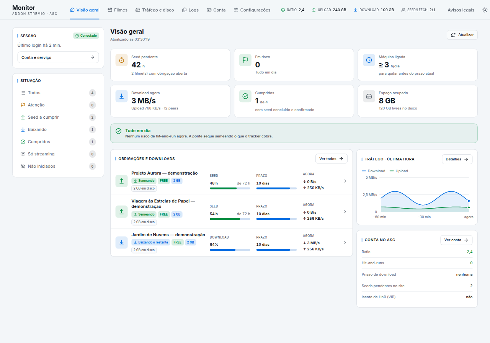
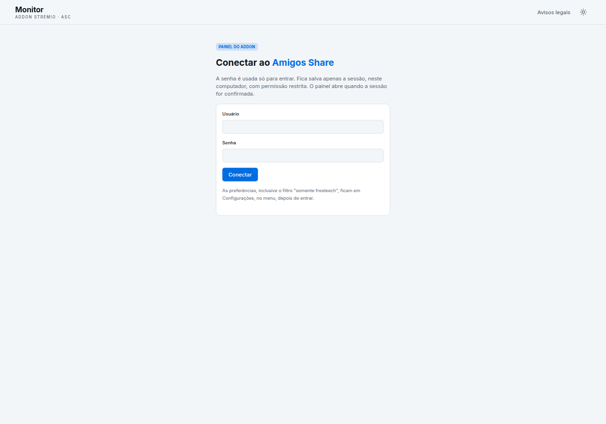
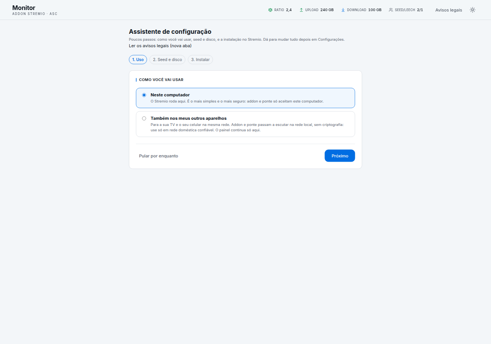
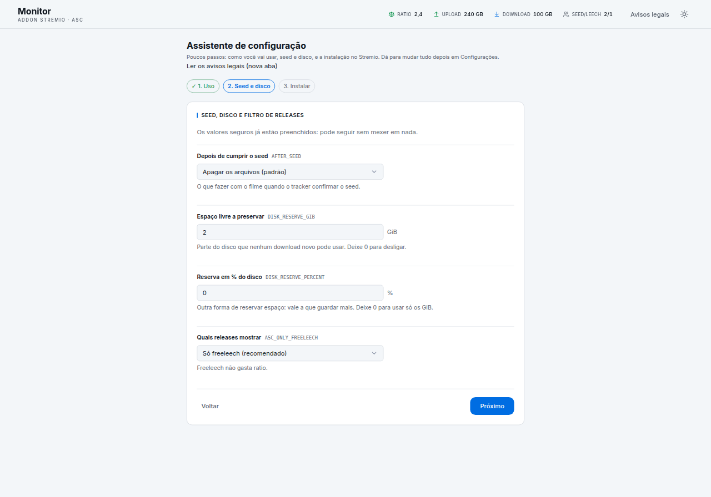
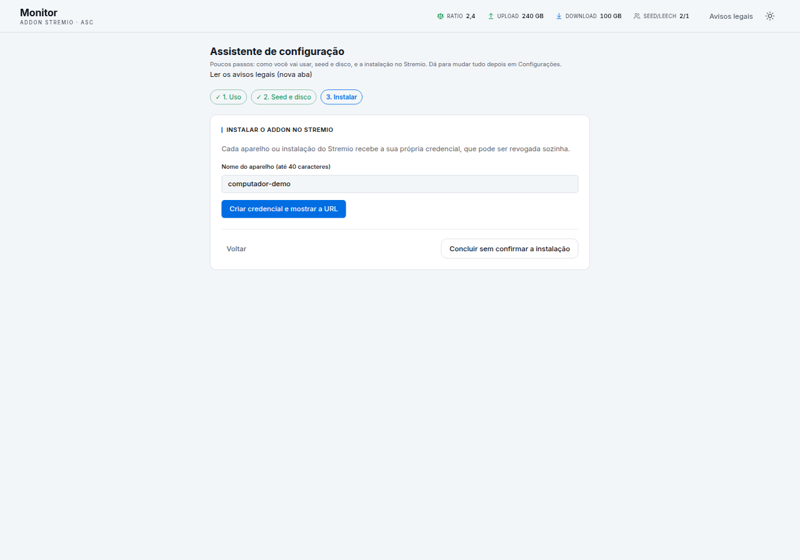
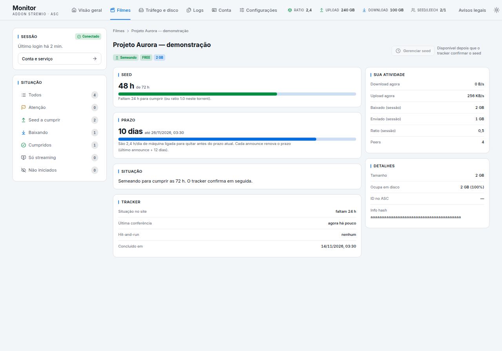
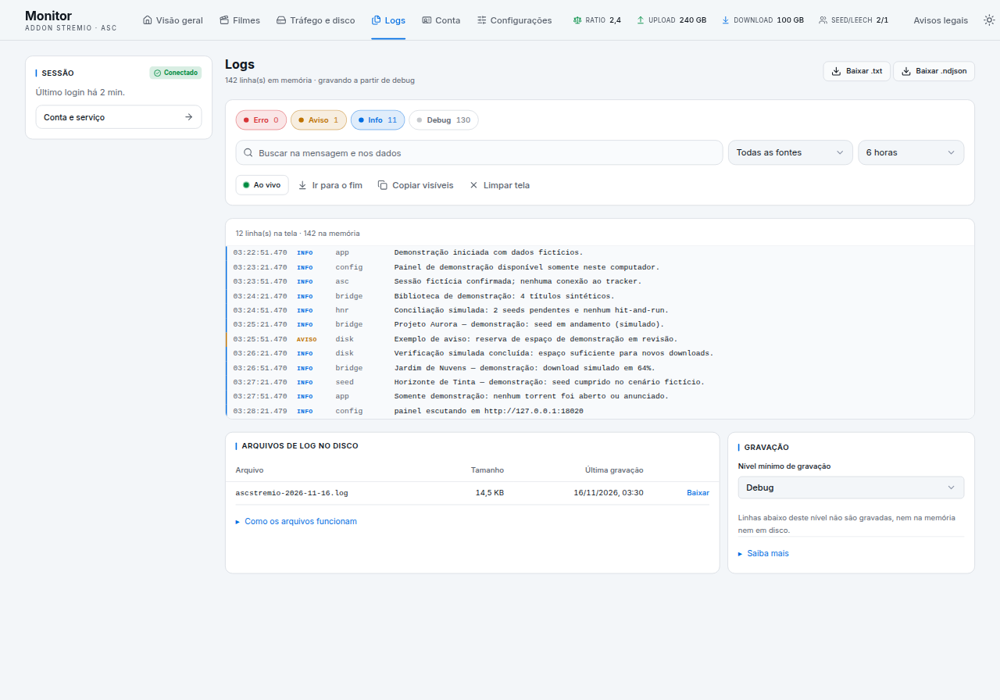

# ASCStremio

Addon independente para usar sua conta do Amigos Share (ASC) no Stremio, com reprodução por uma ponte local e acompanhamento das obrigações de seed.

**Projeto independente, sem vínculo, afiliação ou endosso do Amigos Share.** **Uma conta, uma pessoa, uma instalação.** O projeto não fornece conteúdo nem credenciais e não garante conformidade com as regras do tracker. A máquina que executa o ASCStremio baixa e compartilha os arquivos por BitTorrent; ela precisa permanecer ligada durante o seed. Não exponha os serviços HTTP à internet nem ofereça acesso a terceiros.

> [!NOTE]
> **Abrir o painel de outro computador da rede:** o painel só abre no computador do servidor, a menos que você ligue a administração pela LAN, com senha. No Windows use **Painel pela rede** no Menu Iniciar (ou na bandeja); nos demais, `npm run admin-painel -- assistente`. Detalhes em [configuração](docs/configuracao.md#administração-do-painel-pela-lan).

## Conheça o painel

Acompanhe downloads, seed, prazos e espaço em disco em uma única tela.

<picture>
  <source media="(prefers-color-scheme: dark)" srcset="docs/imagens/painel-escuro.png">
  
</picture>

Capturas da versão **0.6.0**, feitas em **16/11/2026**, com títulos, conta e valores fictícios.

<details>
<summary>Conectar a conta</summary>

A entrada começa pelo login no painel local.

<picture>
  <source media="(prefers-color-scheme: dark)" srcset="docs/imagens/login-escuro.png">
  
</picture>

</details>

<details>
<summary>Configurar a instalação pelo assistente</summary>

**Escolha onde usar:** neste computador ou nos seus outros aparelhos da rede.

<picture>
  <source media="(prefers-color-scheme: dark)" srcset="docs/imagens/wizard-uso-escuro.png">
  
</picture>

**Confira seed e disco:** política após o seed, reserva de espaço e filtro freeleech.

<picture>
  <source media="(prefers-color-scheme: dark)" srcset="docs/imagens/wizard-seed-escuro.png">
  
</picture>

**Instale no Stremio:** crie uma credencial para cada aparelho.

<picture>
  <source media="(prefers-color-scheme: dark)" srcset="docs/imagens/wizard-instalar-escuro.png">
  
</picture>

</details>

<details>
<summary>Acompanhar um torrent</summary>

Veja o progresso de seed, o prazo, a conferência do tracker e a atividade daquele torrent.

<picture>
  <source media="(prefers-color-scheme: dark)" srcset="docs/imagens/torrent-escuro.png">
  
</picture>

</details>

<details>
<summary>Consultar os logs</summary>

Filtre mensagens por nível, fonte e período para investigar o funcionamento do aplicativo.

<picture>
  <source media="(prefers-color-scheme: dark)" srcset="docs/imagens/logs-escuro.png">
  
</picture>

</details>

## O que você encontra

- Busca de filmes e séries no ASC e fontes com informações de qualidade, áudio, tamanho e freeleech.
- Séries: episódios avulsos, temporadas e packs, com o estado de cada episódio no painel, download e exclusão por episódio ou temporada e conferência por peças.
- Reprodução sob demanda: listar fontes não baixa o `.torrent` nem entra no swarm.
- Painel local para acompanhar conta, downloads, espaço em disco, seed e logs.
- Retomada de torrents pendentes e conciliação com o tracker, que decide se o seed foi cumprido.
- Instalação Linux, Docker/Podman e Windows (serviço do Windows que sobe com o computador, com ícone na bandeja); execução manual com Node.js 22 ou superior.
- Painel que também abre em outros computadores da rede, com senha, quando você liga essa opção.

A integração online cobre **filmes com um vídeo principal** e **séries** (episódios avulsos, temporadas e packs). Coleções de filmes com vídeos de tamanhos parecidos e imagens de disco não são reproduzidas. Veja [compatibilidade e funcionamento das fontes](docs/uso.md).

## Comece aqui

No Linux, instale pelo script do GitHub:

```bash
curl -fsSL https://raw.githubusercontent.com/msouza10/ascstremio/main/scripts/install-remote.sh | \
  ASCSTREMIO_BASE_URL=https://github.com/msouza10/ascstremio/releases/latest/download bash
```

Se o repositório estiver privado, esse `curl` falha com 404 ou 401: use o download autenticado pelo `gh` descrito no [guia de instalação](docs/instalacao.md#instalar-pelo-github-com-curl). O guia também lista os pré-requisitos, como atualizar e como desinstalar.

Para Docker/Podman, use a imagem pronta **`ghcr.io/msouza10/ascstremio:latest`**, conforme o [guia de instalação](docs/instalacao.md#usar-a-imagem-pronta-do-ghcr). O guia também cobre Windows e acesso autenticado quando o repositório ou pacote são privados.

Para executar a partir do código, com Node.js 22+ e npm disponíveis:

```bash
npm ci
npm start
```

1. Abra o painel em **http://127.0.0.1:7020/** e conecte sua conta individual do ASC. O filtro **somente freeleech** começa ativado.
2. Configure sua passkey conforme o [guia de instalação](docs/instalacao.md#passkey-do-tracker). A senha de login e a passkey têm funções diferentes.
3. Emita a credencial de reprodução com `npm run credenciais -- garantir` (o instalador Linux já faz isso) e instale no Stremio a URL `http://127.0.0.1:7000/<credencial>/manifest.json` que ele mostra, uma única vez. Detalhes em [segurança](docs/seguranca.md#credenciais-de-instalação-do-addon).
4. Em Descobrir → Filmes, abra **ASC — filmes**. Use **ASC — status** e o painel para acompanhar pendências.

Use `npm start`, que inclui a opção de cabeçalhos HTTP exigida pela integração. Se já houver uma instalação em execução, pare-a antes de iniciar outra com as mesmas portas e pasta de dados.

## Antes de assistir

Leia os [avisos legais](LEGAL.md): o uso da integração exige verificar as permissões aplicáveis,
e a máquina baixa e compartilha arquivos por BitTorrent. O texto não garante autorização das obras
nem regularidade da conta. A [matriz de conformidade](docs/conformidade-juridica.md) compara os avisos,
o código e as pendências técnicas e jurídicas identificadas.

O painel oferece **Avisos legais** no cabeçalho e no assistente, em uma nova aba, mesmo antes do
login. O caminho `/avisos-legais` mostra o texto da sua versão instalada sem precisar de internet.

O padrão `AFTER_SEED=delete` **apaga os arquivos de vídeo depois que o tracker confirma o cumprimento do seed**. Use `stop` para manter os arquivos ou `keep` para continuar semeando. Reproduzir um filme removido pode baixar tudo novamente e gerar nova obrigação.

Freeleech não dispensa seed. O aplicativo acompanha a meta de 72 horas ou ratio 1,0 por torrent, o prazo de hit-and-run e a inatividade da conta; isso não garante que sua conta esteja regular. Leia [seed e regras operacionais](docs/seed.md) e confira as regras atuais no ASC.

## Documentação

| Preciso de… | Onde ler |
|---|---|
| Instalar, conectar a conta e configurar a passkey | [Instalação](docs/instalacao.md) |
| Entender fontes, reprodução, painel e status no Stremio | [Uso](docs/uso.md) |
| Alterar portas, diretórios e políticas | [Configuração](docs/configuracao.md) |
| Entender seed, conclusão e liberação dos arquivos | [Seed e regras operacionais](docs/seed.md) |
| Atualizar, fazer backup ou investigar um erro | [Manutenção e diagnóstico](docs/manutencao.md) |
| Entender exposição de rede e proteção dos dados | [Segurança](docs/seguranca.md) |
| Conhecer componentes e rotas | [Arquitetura e interfaces](docs/arquitetura.md) |
| Contribuir, testar ou montar pacotes | [Desenvolvimento e releases](docs/desenvolvimento.md) |

O [índice dos guias](docs/README.md) organiza a leitura por tarefa. O [changelog](CHANGELOG.md) registra as versões.

## Limites atuais

Os serviços HTTP ficam no loopback do host por padrão. O modo LAN é opcional e tem limitações; a administração da ponte exige um token próprio (`admin-key`), separado das credenciais de reprodução, que são individuais e revogáveis. A porta de peers BitTorrent tem exposição diferente dos serviços HTTP. Portas, modos e variáveis estão na [tabela de rede](docs/seguranca.md#portas-e-interfaces); TV e celular só precisam do streaming, nunca do painel. A `?k=` e a URL do addon são credenciais reutilizáveis: não as compartilhe em capturas, chats ou diagnósticos. Consulte [segurança e rede](docs/seguranca.md) antes de alterar a instalação.

As auditorias de segredos anteriores do histórico e dos artefatos, incluindo a imagem GHCR da versão 0.2.0, estão registradas na [issue #11](https://github.com/msouza10/ascstremio/issues/11). Elas se limitam às revisões e aos artefatos examinados; a barreira e as auditorias devem continuar nas novas distribuições. A validação das permissões da integração é acompanhada na [issue #94](https://github.com/msouza10/ascstremio/issues/94). O código é distribuído sob a [licença MIT](LICENSE). O uso de conta individual não equivale a autorização do tracker nem concede direitos sobre conteúdo de terceiros.

Para contribuir, leia o [guia de contribuição](.github/CONTRIBUTING.md) e o [código de conduta](.github/CODE_OF_CONDUCT.md). Vulnerabilidades devem seguir a [política de segurança](.github/SECURITY.md).
