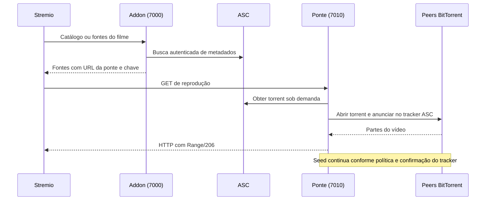

# Arquitetura e interfaces locais

O ASCStremio é um processo Node.js CommonJS que coordena três servidores HTTP e um motor BitTorrent para uma conta individual. Não há banco de dados externo, build de frontend, transcodificação ou serviço central compartilhado.

## Fluxo de reprodução

O download do torrent usa a sessão do site. O announce usa a passkey, injetada em memória. Listagem e HEAD não entram no swarm. O cofre mantém obrigações locais, e o vigia reconcilia com o histórico/atividade do tracker.

## Componentes

| Código | Responsabilidade |
|---|---|
| `src/credentials.js`, `src/addon-auth.js`, `src/credenciais-cli.js` | Credenciais de instalação (emissão, verificador, revogação), porta autenticada do addon e CLI de gestão |
| `src/config-admin.js`, `src/configurar-cli.js` | Operações de configuração (leitura, alteração com trava da instância e revisão, recuperação) e a CLI/menu do terminal; a lógica é separada da apresentação para o assistente web reutilizar |
| `src/index.js` | Ambiente, composição dos servidores e encerramento |
| `src/addon.js`, `src/asc-provider.js` | Catálogos, busca e fontes; resolução online sob demanda |
| `src/asc-client.js` | Login, cookies, serialização de consultas, download e leitura da atividade/conta |
| `src/library.js` | Leitura da biblioteca e seleção do vídeo principal |
| `src/bridge.js` | Motor BitTorrent, streaming Range, conclusão, retomada e liberação |
| `src/seedvault.js`, `src/hnr-guard.js` | Persistência e conciliação das obrigações; tracker prevalece |
| `src/config-server.js`, `src/ui/` | Painel, login, monitor e logs; frontend em JavaScript puro |
| `src/stremio-status.js` | Catálogo e cartões SVG de status |
| `src/passkey.js`, `src/safety.js` | Credenciais do announce, interfaces de escuta e salvaguardas de rede |
| `src/logger.js`, `src/keepawake.js` | Logs redigidos e bloqueio de suspensão |

Os servidores ficam disponíveis antes da retomada dos torrents, pois verificar arquivos grandes pode demorar. SIGINT/SIGTERM fecham os servidores e param a ponte; o launcher Windows tem uma estratégia diferente, descrita em [instalação](instalacao.md).

## Ponte HTTP

Rotas relativas a `http://127.0.0.1:7010`, com as verificações de Host habilitadas pelo programa principal. Esta referência descreve o contrato atual, sem recomendar exposição na rede.

| Método e rota | Finalidade | Controle atual |
|---|---|---|
| `GET /health` | Saúde do processo e quantidade de torrents | Host permitido; não comprova sessão ou regularidade da conta |
| `GET/HEAD /a/<id>` | Fonte online resolvida sob demanda | Credencial `?k=` ativa; HEAD não baixa torrent |
| `GET/HEAD /s/<hash>/<idx>` | Arquivo de torrent da biblioteca | Credencial `?k=` ativa; suporte a Range na reprodução |
| `GET/POST /credentials`, `POST /credentials/revoke?id=`, `POST /credentials/rotate?id=` | Lista, emite (`name`, `status=1`), revoga e gira credenciais de instalação | `X-Admin-Token`, sem Origin; fora do contêiner, também loopback; só aqui o token aparece, uma vez |
| `GET /status` | Estado dos torrents no motor | `X-Admin-Token`, sem Origin; fora do contêiner, também loopback |
| `GET /seed-status` | Cofre, pendências e avisos | `X-Admin-Token`, sem Origin; fora do contêiner, também loopback |
| `POST /complete?hash=<infoHash>` | Solicita download completo em segundo plano | `X-Admin-Token`, sem Origin; fora do contêiner, também loopback; valida hash |
| `GET /retention` | Prévia da retenção por orçamento (somente leitura, sem rede) | `X-Admin-Token`, sem Origin; fora do contêiner, também loopback |
| `POST /retention/run?plan=<id>` | Executa o plano emitido pela prévia, relendo o tracker e reconferindo cada título | `X-Admin-Token`, sem Origin; fora do contêiner, também loopback; 409/503 sem remover nada se o plano expirou, a retenção está desligada ou o tracker falha |
| `POST /cleanup[?hash=<infoHash>]` | Remove torrents e armazenamento após conferir obrigações | `X-Admin-Token`, sem Origin; fora do contêiner, também loopback; consulta o tracker |

As rotas administrativas exigem o cabeçalho `X-Admin-Token`, com o conteúdo de `DATA_DIR/admin-key` (a credencial de reprodução `?k=` não vale aqui). O token nunca vai na URL. Sem ele, ou com `Origin`, a resposta é 403 antes de qualquer leitura ou efeito. `/cleanup` não aceita mais `force=1`: só libera o que o tracker confirmou cumprido, e responde 409 com o que falta. Detalhes em [segurança](seguranca.md).

## Painel HTTP

Rotas relativas a `http://127.0.0.1:7020`. Todas exigem Host exato; as ações POST exigem Origin exata, `Content-Type: application/json` e `X-CSRF-Token` obtido pela própria página. O token muda quando o painel reinicia.

| Método e rota | Uso |
|---|---|
| `GET /api/status` | Situação da sessão |
| `GET /api/monitor` | Snapshot da ponte/conta; exige sessão ASC confirmada |
| `POST /api/login` | Login com `username`, `password` e `onlyFreeleech` |
| `POST /api/verify` | Confirma sessão existente |
| `POST /api/logout` | Remove sessão local |
| `POST /api/complete` | Conclusão com `infoHash`; exige sessão confirmada |
| `GET /api/logs` | Consulta filtrada e paginada de logs |
| `GET /api/logs/files` | Lista arquivos de log |
| `GET /api/logs/download` | Exporta seleção; `formato=ndjson` seleciona NDJSON |
| `GET /api/logs/file?nome=<arquivo>` | Obtém arquivo diário validado pelo logger |
| `POST /api/logs/level` | Altera mínimo com o campo `nivel` |

As rotas de log funcionam sem sessão ASC para diagnóstico local. A interface usa polling; não há WebSocket. O painel não publica uma API remota multiusuário nem promete estabilidade de todos os campos internos. Com a [administração pela LAN](seguranca.md#administração-do-painel-pela-lan) ativa, `GET/POST/DELETE /api/admin/session` entram e saem da sessão de administração e todas as demais rotas `/api` (inclusive logs) exigem essa sessão, com Host/Origin exatos do endereço configurado e CSRF por sessão.

## Addon HTTP

Todas as rotas ficam sob o prefixo da credencial: `/<credencial>/manifest.json`, `/<credencial>/catalog/…`, `/<credencial>/meta/…`, `/<credencial>/stream/…` e `/<credencial>/status/poster/<id>.svg`. Sem credencial ativa (ausente, errada ou revogada) a resposta é 403, inclusive para o manifesto; rotas fora dessa lista dão 404. O prefixo é removido antes de chegar ao roteador do SDK (`src/addon-auth.js`) e o token acompanha a requisição para montar as URLs de vídeo com a mesma credencial.

O SDK Stremio fornece manifesto, catálogos, metadados e fontes. `/status/poster/<id>.svg` gera os cartões do monitor para identificadores existentes no estado atual. IDs IMDb de filmes e identificadores locais são convertidos pelos provedores; aceitar o formato de um episódio no parser não implica suporte online a séries.

As fontes da ponte usam `behaviorHints.notWebReady` para o cliente escolher uma reprodução compatível. Não há conversão para magnet público, descoberta pública nem reprodução BitTorrent delegada ao motor do Stremio.

## Persistência e fronteiras

`DATA_DIR` separa estado da instalação e código atualizável. Sessão, chave, cofre e arquivos precisam ser preservados de forma consistente; veja [backup](manutencao.md#backup-e-restauração). Notas locais e sondas do mantenedor não são dependências do programa, dos testes ou da CI.

`meta-cache.json` (`src/meta-cache.js`) guarda, por filme IMDb, apenas nome, tamanho e selos dos releases vistos numa busca online bem-sucedida (até 300 filmes, 12 releases, 512 KiB, 90 dias; escrita atômica, modo 0600, formato versionado; arquivo ilegível é ignorado). Serve só à queda para arquivos locais completos quando o ASC está indisponível (`lookup` em `src/asc-provider.js`); não substitui a consulta ao tracker nem guarda seeders, freeleech, cookies ou passkey.

Os testes usam ASC, torrents e respostas simulados. Passar na suíte não confirma regras atuais do tracker, disponibilidade real do swarm ou suporte de codecs do player.
